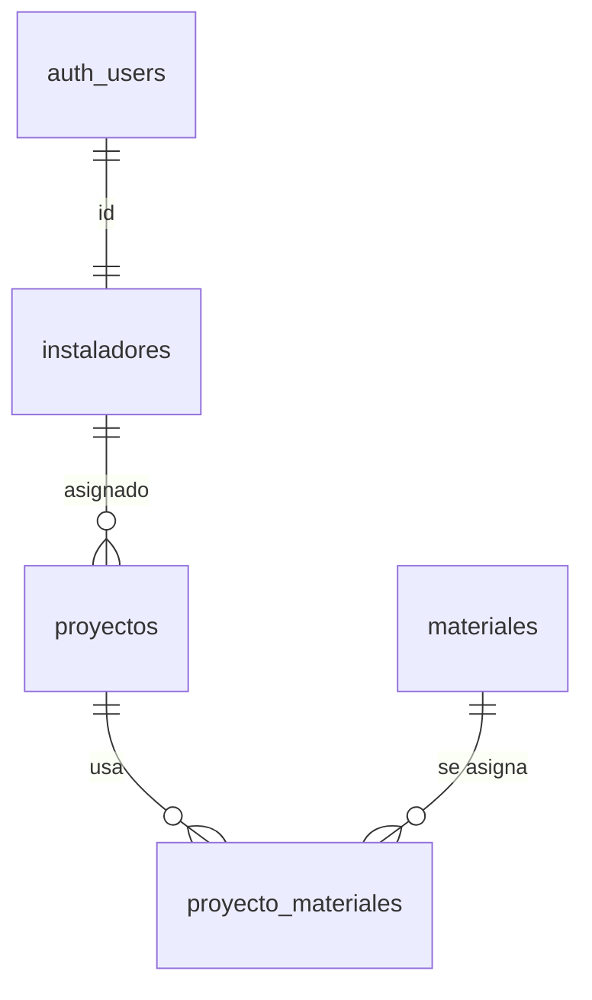

# EcoFlow — Documento de Arquitectura

**Stack:** React + Vite + TypeScript · Tailwind + shadcn/ui · Supabase

Flujo SDD: **modelado → contratos → generación con IA → validación**.

## 1. Modelo de datos



```sql
create type estado_proyecto as enum ('pendiente','en_progreso','completado');

create table instaladores (
  id uuid primary key references auth.users on delete cascade,
  nombre text not null check (char_length(nombre) between 2 and 80),
  rol text not null default 'instalador' check (rol in ('instalador','admin'))
);
create table proyectos (
  id uuid primary key default gen_random_uuid(),
  nombre text not null check (char_length(nombre) between 3 and 120),
  cliente text not null,
  capacidad_kw numeric(8,2) not null check (capacidad_kw > 0),
  estado estado_proyecto not null default 'pendiente',
  instalador_id uuid references instaladores on delete set null,
  fecha_inicio date,
  created_at timestamptz not null default now()
);
create index on proyectos (instalador_id, estado);
create table materiales (
  id uuid primary key default gen_random_uuid(),
  nombre text not null unique,
  unidad text not null,
  stock int not null default 0 check (stock >= 0)
);
create table proyecto_materiales (
  proyecto_id uuid references proyectos on delete cascade,
  material_id uuid references materiales on delete restrict,
  cantidad int not null check (cantidad > 0),
  primary key (proyecto_id, material_id)
);
```

**Decisiones:** tabla puente con cantidades; `restrict` impide borrar materiales en uso; `enum` y `check` validan en la BD; el índice acelera RLS y dashboard.

## 2. Políticas RLS

```sql
alter table instaladores enable row level security;
alter table proyectos enable row level security;
alter table materiales enable row level security;
alter table proyecto_materiales enable row level security;

create function public.es_admin() returns boolean
language sql stable security definer set search_path = '' as $$
  select exists (select 1 from public.instaladores
                 where id = (select auth.uid()) and rol = 'admin');
$$;

create policy inst_select on instaladores for select to authenticated
  using (id = (select auth.uid()) or (select public.es_admin()));

create policy proy_select on proyectos for select to authenticated
  using (instalador_id = (select auth.uid()) or (select public.es_admin()));
create policy proy_admin on proyectos for all to authenticated
  using ((select public.es_admin())) with check ((select public.es_admin()));

create policy mat_select on materiales for select to authenticated using (true);
create policy mat_admin on materiales for all to authenticated
  using ((select public.es_admin())) with check ((select public.es_admin()));

-- Hereda la RLS de proyectos
create policy pm_select on proyecto_materiales for select to authenticated
  using (exists (select 1 from proyectos p where p.id = proyecto_id));
```

El instalador no tiene `UPDATE`: cambia el estado con una RPC que solo toca esa columna.

```sql
create function public.cambiar_estado(p_id uuid, p_estado estado_proyecto)
returns void language plpgsql security definer set search_path = '' as $$
begin
  update public.proyectos set estado = p_estado
  where id = p_id and (instalador_id = (select auth.uid()) or public.es_admin());
  if not found then raise exception 'Proyecto no encontrado o no autorizado'; end if;
end; $$;
```

## 3. Prompt maestro (especificación técnica)

```
ROL: Desarrollador senior React + TypeScript + Supabase.
CONTEXTO: App interna EcoFlow. Esquema SQL adjunto y tipos en database.types.ts.
REGLAS DE NEGOCIO:
- Instalador: ve solo sus proyectos y cambia su estado con rpc('cambiar_estado').
- Admin: crea proyectos, asigna instaladores y gestiona materiales.
- Estados: pendiente → en_progreso → completado.
- capacidad_kw > 0; nombre de 3 a 120 caracteres.
CONTRATOS:
- useProyectos() → { proyectos, isLoading, error, crearProyecto, cambiarEstado }
- crearProyecto(ProyectoInsert) → Proyecto | lanza Error
RESTRICCIONES:
- Supabase solo dentro de hooks; los componentes no lo importan.
- Tipado estricto, sin any. Validación con Zod + react-hook-form.
- UI con componentes shadcn/ui y Tailwind.
- Estados loading / error / vacío.
FORMATO: un archivo por respuesta.
```

## 4. Estructura del frontend

Hooks en `src/hooks` (Supabase solo aquí), componentes shadcn en `src/components/ui`, páginas en `src/pages`.


Tipos: `npx supabase gen types typescript --project-id <ref> > src/types/database.types.ts`. La IA generó el esquema Zod desde esos tipos; `satisfies` garantiza que no se desalinee.

### Hook `useProyectos.ts`

```ts
type Proyecto = Tables<'proyectos'> & { instaladores: { nombre: string } | null };

export function useProyectos() {
  const [proyectos, setProyectos] = useState<Proyecto[]>([]);
  const [isLoading, setIsLoading] = useState(true);
  const [error, setError] = useState<string | null>(null);

  const cargar = useCallback(async () => {
    const { data, error } = await supabase.from('proyectos')
      .select('*, instaladores(nombre)')
      .order('created_at', { ascending: false });
    if (error) setError(error.message); else setProyectos(data as Proyecto[]);
    setIsLoading(false);
  }, []);

  useEffect(() => {
    cargar();
    const ch = supabase.channel('proyectos')
      .on('postgres_changes', { event: '*', schema: 'public', table: 'proyectos' }, cargar)
      .subscribe();
    return () => { supabase.removeChannel(ch); }; // cleanup
  }, [cargar]);

  const crearProyecto = async (p: TablesInsert<'proyectos'>) => {
    const { error } = await supabase.from('proyectos').insert(p);
    if (error) throw new Error(error.message);
  };

  const cambiarEstado = async (id: string, estado: Enums<'estado_proyecto'>) => {
    const prev = proyectos;
    setProyectos((l) => l.map((x) => (x.id === id ? { ...x, estado } : x))); // optimista
    const { error } = await supabase.rpc('cambiar_estado', { p_id: id, p_estado: estado });
    if (error) { setProyectos(prev); setError(error.message); }
  };

  return { proyectos, isLoading, error, crearProyecto, cambiarEstado };
}
```

### Formulario validado `ProyectoForm.tsx`

```tsx
const schema = z.object({
  nombre: z.string().trim().min(3).max(120),
  cliente: z.string().trim().min(2),
  capacidad_kw: z.coerce.number().positive('Debe ser mayor a 0'),
  instalador_id: z.string().uuid('Selecciona un instalador'),
  fecha_inicio: z.string().optional(),
}) satisfies z.ZodType<Partial<TablesInsert<'proyectos'>>>;

export function ProyectoForm({ onCreate }: { onCreate: (v: z.infer<typeof schema>) => Promise<void> }) {
  const form = useForm<z.infer<typeof schema>>({ resolver: zodResolver(schema) });
  const { errors, isSubmitting } = form.formState;
  return (
    <form onSubmit={form.handleSubmit(onCreate)} className="grid gap-3">
      <Input placeholder="Nombre del proyecto" {...form.register('nombre')} />
      {errors.nombre && <p className="text-sm text-destructive">{errors.nombre.message}</p>}
      <Input type="number" step="0.1" placeholder="Capacidad (kW)" {...form.register('capacidad_kw')} />
      <Button disabled={isSubmitting}>{isSubmitting ? 'Guardando…' : 'Crear proyecto'}</Button>
    </form>
  );
}
```

### Dashboard por estado

```tsx
const ESTADOS = ['pendiente', 'en_progreso', 'completado'] as const;

export function Dashboard() {
  const { proyectos, isLoading, error } = useProyectos();
  if (isLoading) return <Skeleton className="h-40" />;
  if (error) return <Alert variant="destructive">{error}</Alert>;
  return (
    <div className="grid gap-4 md:grid-cols-3">
      {ESTADOS.map((e) => (
        <Card key={e}>
          <CardHeader><CardTitle>{e.replace('_', ' ')}</CardTitle></CardHeader>
          <CardContent>
            {proyectos.filter((p) => p.estado === e).map((p) => (
              <div key={p.id} className="flex justify-between py-1">
                <span>{p.nombre}</span><Badge>{p.capacidad_kw} kW</Badge>
              </div>
            ))}
          </CardContent>
        </Card>
      ))}
    </div>
  );
}
```

## 5. Problema complejo resuelto con IA: recursión infinita en RLS

**Síntoma:** al pedir *"crea una política para que el admin vea todos los instaladores"*, la IA propuso `using (exists (select 1 from instaladores where id = auth.uid() and rol = 'admin'))`. Al consultar, Postgres respondió `infinite recursion detected in policy for relation "instaladores"`: la política consulta la misma tabla que protege.

**Iteración con la IA:** *"La política genera recursión infinita porque se consulta a sí misma. Restricciones: no desactivar RLS ni usar service_role en el cliente. Propón una solución y explica sus implicaciones de seguridad."* La IA propuso la función `es_admin()` con `security definer` y `search_path = ''`, que lee la tabla sin reevaluar la política.

**Validación propia:** envolví las llamadas en `(select ...)` para evaluarlas una vez por consulta. Probé con dos instaladores y un admin: cada instalador ve solo lo suyo y `cambiar_estado` sobre un proyecto ajeno falla. Descarté la sugerencia de la IA de dar `UPDATE` completo al instalador, porque podría reasignarse proyectos.

## 6. Video demo

Demo de unos 4 minutos. Inicio sesión como administrador y muestro el dashboard agrupado por estado. Creo un proyecto con el formulario, provoco errores de validación (capacidad negativa, nombre corto) y luego lo guardo correctamente. Después entro como instalador en otra ventana: solo ve sus proyectos asignados, y al cambiar un estado la columna del administrador se actualiza en tiempo real. Al final muestro en la consola de Supabase las tablas, sus relaciones y las políticas RLS activas.
